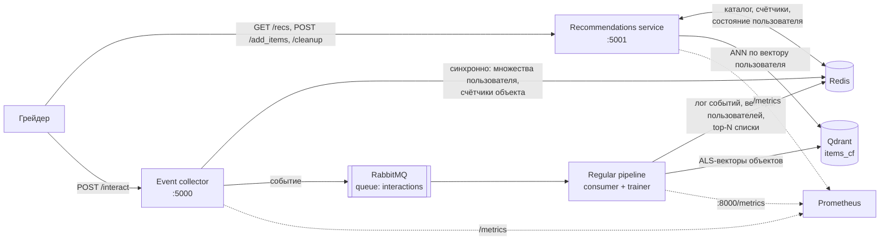

# Сервис рекомендаций фильмов и сериалов

[](https://github.com/OWNER/rec-sys-kc-final-project/actions/workflows/ci.yml)

Финальный проект курса по рекомендательным системам: онлайн-сервис, который получает каталог объектов
с жанрами, отдаёт персональные рекомендации и учится на лайках/дизлайках пользователей в реальном времени.

Стек: **FastAPI · Redis · RabbitMQ · Qdrant · numpy/scipy · Docker Compose · Prometheus**.

## Содержание

- [Постановка задачи](#постановка-задачи)
- [Архитектура](#архитектура)
- [Алгоритм рекомендаций](#алгоритм-рекомендаций)
- [API](#api)
- [Быстрый старт](#быстрый-старт)
- [Симулятор грейдера и результаты](#симулятор-грейдера-и-результаты)
- [Деплой на ВМ](#деплой-на-вм)
- [Конфигурация](#конфигурация)
- [Разработка](#разработка)
- [Ограничения и допущения](#ограничения-и-допущения)

## Постановка задачи

Проверяющая система (грейдер) работает с сервисом так:

1. `POST /cleanup` — сброс состояния перед прогоном;
2. `POST /add_items` — загрузка каталога: идентификаторы объектов и списки жанров;
3. много раундов `GET /recs/{user_id}` → показ → `POST /interact` с реакцией `like`/`dislike`;
   между раундами есть короткие и длинные паузы, одновременно обслуживается до 50 пользователей.

Никаких исторических данных нет: и каталог, и фидбек приходят только во время прогона. Задача целиком про
холодный старт, исследование интересов и быстрый учёт обратной связи.

| Метрика (TOP_K = 10)        | Минимум | Максимум | Баллы |
|-----------------------------|--------:|---------:|------:|
| precision                   |    0.02 |     0.15 |    10 |
| ndcg                        |    0.02 |     0.07 |    10 |
| diversity                   |    0.10 |     0.40 |    10 |
| coverage                    |    0.10 |     0.80 |    10 |
| время ответа (бонус)        |  800 мс |    80 мс |    10 |

Объект, уже показанный пользователю, в следующей сессии релевантным не считается, поэтому списки
не должны повторяться, а каталог нужно исследовать широко.

## Архитектура



**Recommendations service** (`services/recommendations`) — FastAPI на порту 5001. Держит в памяти
*снапшот* каталога (жанровые векторы) и счётчиков популярности, обновляемый фоном раз в 2 с, поэтому в
горячем пути остаются один pipeline-запрос в Redis за состоянием пользователя, один ANN-запрос в Qdrant и
numpy-арифметика. Среднее время ответа — единицы миллисекунд.

**Event collector** (`services/event_collector`) — FastAPI на порту 5000. Принимает лайки/дизлайки и
делает две вещи: синхронно обновляет лёгкое состояние в Redis (множества `liked`/`disliked` пользователя,
счётчики объекта), чтобы уже следующий запрос рекомендаций учёл фидбек, и публикует событие в RabbitMQ.
Это осознанный dual-write: путь через очередь не гарантирует, что событие будет обработано до следующего
`GET /recs`, а грейдер шлёт запросы с короткими паузами.

**Regular pipeline** (`services/pipeline`) — аналог планировщика. Две корутины: потребитель очереди
(пишет события в Redis Stream `events` и идемпотентно применяет их к состоянию — страхующий путь) и тренер,
который раз в `TRAIN_INTERVAL_SEC` обучает implicit ALS на матрице лайков, складывает векторы объектов в
Qdrant, а векторы пользователей и предрассчитанные top-N списки — в Redis.

**Хранилища.** Redis — состояние и предрассчитанные списки, Qdrant — ALS-векторы объектов (поиск по
скалярному произведению), RabbitMQ — очередь событий. Схема ключей Redis описана в
[`src/recsys/storage/redis_store.py`](src/recsys/storage/redis_store.py).

`/cleanup` делает `FLUSHDB`, удаляет коллекцию Qdrant, очищает очередь и повышает счётчик `epoch`;
сервисы сравнивают эпоху и сбрасывают кэши, поэтому между прогонами грейдера ничего не протекает.

## Алгоритм рекомендаций

Гибрид, который плавно переходит от исследования к персонализации по мере накопления фидбека.
Для пользователя `u` и каждого объекта `i` каталога считается

```
score(i) = w_pop     · norm(log CTR_i)                 # популярность: доля лайков на показ
         + w_content · cos(profile_u, genres_i)        # контентная часть
         + w_cf      · cf_u(i)                         # коллаборативная часть (ALS)
         + w_explore · 1 / sqrt(1 + shows_i)           # бонус редко показанным

CTR_i = (likes_i + s · prior_i) / (shows_i + s)        # апостериорное среднее Beta-модели
```

1. **Популярность как CTR.** Фидбек приходит не на каждый показ, а только на объекты, которые
   пользователь когда-то оценил, поэтому знаменатель — показы, а не дизлайки. Априорный CTR `prior_i` —
   средний сглаженный CTR жанров объекта, так что непоказанные объекты «любимых» жанров стартуют
   с преимуществом. Ранжирование идёт по апостериорному среднему, а не по Thompson-семплу: горизонт
   короткий (три запроса на пользователя при тысячах пользователей параллельно), и в симуляции шум
   семпла при десятке показов на объект снижал точность в 2–4 раза. Исследование обеспечивают джиттер
   на холодном старте (все CTR равны, списки получаются случайными и разными у разных пользователей),
   слот исследования и бонус редко показанным. Thompson sampling оставлен как опция `POP_SAMPLING`.
2. **Контентный профиль.** `profile_u` — нормированная сумма жанровых векторов лайкнутых объектов минус
   `DISLIKE_WEIGHT` × векторы дизлайкнутых. Дизлайк чаще означает «не тот фильм», чем «не тот жанр»,
   поэтому его вес меньше. Профиль пересчитывается на каждом запросе — фидбек учитывается мгновенно.
3. **Коллаборативная часть.** Pipeline обучает implicit ALS (Hu, Koren, Volinsky) на матрице лайков;
   в горячем пути вектор пользователя из Redis отправляется в Qdrant, возвращённые кандидаты получают
   нормированный скор. Если Qdrant недоступен — используется предрассчитанный top-N из Redis.
   ALS реализован на numpy (`src/recsys/models/cf.py`): данных мало, а нативная зависимость усложняла бы
   сборку образа на arm64 и x86_64.
4. **Фильтры.** Исключаются показанные, лайкнутые и дизлайкнутые объекты — повторов не бывает.
5. **Разнообразие.** Из `N_CANDIDATES` лучших кандидатов список собирается жадным MMR по косинусу
   жанровых векторов (`MMR_LAMBDA`).
6. **Покрытие.** `N_EXPLORE` последних позиций отдаются объектам с минимальным числом показов
   (случайный разрыв ничьих), не противоречащим профилю пользователя.

Жанровые векторы маломерны (десятки жанров), поэтому точный скоринг всего каталога в numpy занимает
доли миллисекунды и быстрее любого сетевого вызова; Qdrant используется там, где ANN нужен по смыслу —
для ALS-векторов.

## API

### Recommendations service — порт 5001

| Метод | Путь | Назначение |
|-------|------|------------|
| GET | `/healthcheck` | статус сервиса, всегда 200 |
| POST (GET, DELETE) | `/cleanup` | полный сброс состояния |
| POST | `/add_items` | добавить объекты: `{"item_ids": [...], "genres": [[...], ...]}` |
| GET | `/recs/{user_id}` | список рекомендаций |
| GET | `/metrics` | Prometheus |

```bash
curl -X POST localhost:5001/add_items -H 'content-type: application/json' \
  -d '{"item_ids": [1, 2, "tt0111161"], "genres": [["Drama"], ["Comedy", "Romance"], ["Drama", "Crime"]]}'

curl localhost:5001/recs/42
# {"user_id": "42", "recs": ["tt0111161", 2, 1], "items": [...], "item_ids": [...], "recommendations": [...]}
```

Идентификаторы возвращаются ровно в том виде, в каком пришли (число остаётся числом, строка — строкой).
Проверяющая система читает ответ как словарь (`response.json().get(...)`), но имя ключа из задания
неизвестно, поэтому список отдаётся сразу под несколькими общепринятыми ключами — лишние клиент
игнорирует. Переменная `RECS_RESPONSE_FORMAT=list` переключает ответ на плоский список.

### Event collector — порт 5000

| Метод | Путь | Назначение |
|-------|------|------------|
| GET | `/healthcheck` | статус сервиса |
| POST | `/interact` | лайк/дизлайк |
| GET | `/metrics` | Prometheus |

```bash
# формат проверяющей системы: параллельные списки объектов и действий
curl -X POST localhost:5000/interact -H 'content-type: application/json' \
  -d '{"user_id": "42", "item_ids": ["tt0111161", "tt0068646"], "actions": ["like", "dislike"]}'
```

Парсер терпим к формату. Помимо основного варианта принимаются одиночное событие
`{"user_id": ..., "item_id": ..., "interaction": "like"}`, список событий и обёртка
`{"user_id": ..., "events": [...]}`; поле реакции ищется среди `interaction`, `reaction`, `event`, `type`,
`action`, `feedback`, `rating`, `value`, `liked`; значения — `like`/`dislike`, `1`/`-1`, `true`/`false`.
Первые `LOG_RAW_REQUESTS` сырых тел запросов пишутся в лог — так можно быстро увидеть реальный формат
грейдера и при необходимости подстроиться. Полный список вариантов — в
[`src/recsys/schemas.py`](src/recsys/schemas.py).

## Быстрый старт

Нужны Docker и Docker Compose v2.

```bash
cp .env.example .env        # при желании поправить порты и гиперпараметры
docker compose up -d --build
docker compose ps

curl localhost:5001/healthcheck
curl localhost:5000/healthcheck
```

> На macOS порт 5000 обычно занят AirPlay Receiver. Задайте в `.env` `EVENT_COLLECTOR_PORT=15000`
> (на ВМ оставьте 5000 — туда ходит грейдер).

Мониторинг: `docker compose --profile monitoring up -d` поднимет Prometheus на `localhost:9090`
со скрейпом всех трёх сервисов (латентность, доля запросов с ALS, события в очереди, обучения).
RabbitMQ Management доступен на `localhost:15672` (guest/guest).

## Симулятор грейдера и результаты

Оффлайн-данных для тюнинга нет, поэтому в репозитории есть эмулятор грейдера `simulator/`:

- каталог берётся из реальной IMDB-выгрузки (`title_id`, `genre`) или генерируется;
- пользователи устроены так, как показал реальный прогон грейдера: каждый заранее оценил несколько
  сотен объектов (лайков втрое больше дизлайков), фидбек приходит только на них, остальные показы
  остаются без реакции; популярность объектов имеет тяжёлый хвост (Zipf), у пользователя 2–3 любимых
  жанра, сила жанровых предпочтений регулируется `--genre-strength`;
- протокол повторяет грейдер: `cleanup → add_items → раунды recs/interact` в формате
  `{"user_id", "item_ids", "actions"}`, до 50 пользователей параллельно, длинная пауза после первого
  раунда, чтобы pipeline успел обучить ALS;
- считаются precision@10, ndcg@10 (релевантность объекта сгорает после первого показа), intra-list
  diversity (1 − средний Jaccard жанров), coverage и латентность со стороны клиента.

Масштаб прогона подобран так, чтобы совпадало число показов на объект с реальным грейдером
(~22: там 24 тыс. объектов и 18 тыс. пользователей по 3 запроса): 4 тыс. объектов, 3 тыс. пользователей,
50 оценённых объектов на пользователя.

```bash
make venv
python -m simulator --users 3000 --rounds 3 --items 4000 --rated-per-user 50 \
    --long-pause-after 1 --long-pause 25
```

<!-- RESULTS:BEGIN -->
Прогон: 3000 пользователей × 3 раундов, каталог 4000 объектов, до 50 параллельных пользователей, Docker Desktop на ноутбуке (`docs/simulation_result.json`).

| Раунд | precision@10 | ndcg@10 | diversity | coverage | p50, мс | p95, мс |
|------:|-------------:|--------:|----------:|---------:|--------:|--------:|
| 1 | 0.015 | 0.017 | 0.890 | 1.000 | 70 | 285 |
| 2 | 0.066 | 0.102 | 0.905 | 1.000 | 72 | 383 |
| 3 | 0.034 | 0.047 | 0.778 | 1.000 | 83 | 331 |
| **итого** | **0.038** | **0.055** | **0.858** | **1.000** | **75** | **326** |

Латентность здесь измерена клиентом вместе с сетью Docker Desktop и очередью из 50 параллельных запросов (клиент на Python сам упирается в CPU); серверная гистограмма `recs_request_seconds` показывает среднее около 1 мс, см. заметку о производительности ниже.
<!-- RESULTS:END -->

Абсолютные значения с грейдером не совпадают (его данные неизвестны), симулятор нужен для сравнения
вариантов. На нём выбирались модель популярности и веса: ранжирование по апостериорному среднему CTR
даёт в 2–4 раза выше precision, чем Thompson sampling, и в 2–3 раза выше, чем исходная модель
`Beta(likes, dislikes)`, при любой силе жанровых предпочтений (см. `POP_MODE`, `POP_SAMPLING`).

## Деплой на ВМ

1. Создать ВМ (Ubuntu), загрузить ssh-ключ, узнать IP.
2. Скопировать проект и запустить установку одной командой:

   ```bash
   make deploy VM=<ip> VM_USER=root
   ```

   Цель `deploy` делает `rsync` репозитория в `/opt/recsys-service` и запускает
   [`deploy/setup_vm.sh`](deploy/setup_vm.sh): ставит Docker с compose-плагином (если их нет), создаёт
   `.env` из примера и выполняет `docker compose up -d --build`.
3. Проверить: `curl http://<ip>:5001/healthcheck` и `curl http://<ip>:5000/healthcheck`.
4. Отправить IP в проверяющую систему. Логи во время прогона: `docker compose logs -f`.

Контейнеры перезапускаются автоматически (`restart: unless-stopped`), состояние Redis намеренно не
персистится — грейдер всё равно начинает с `/cleanup`.

## Конфигурация

Все параметры задаются переменными окружения (см. [`.env.example`](.env.example)).

| Переменная | По умолчанию | Смысл |
|------------|--------------|-------|
| `RECS_RESPONSE_FORMAT` | `dict` | формат ответа `/recs`: `dict` (словарь с синонимами ключей) или `list` |
| `TOP_K` | `10` | размер списка |
| `W_POP`, `W_CONTENT`, `W_CF`, `W_EXPLORE` | `1.0`, `0.4`, `0.3`, `0.1` | веса компонент скоринга |
| `POP_MODE` | `ctr` | модель популярности: `ctr` (лайки/показы) или `legacy` (Beta по лайкам/дизлайкам) |
| `POP_SAMPLING` | `mean` | ранжирование по апостериорному среднему или `thompson` |
| `CTR_PRIOR_STRENGTH` | `10` | вес априорного CTR в псевдопоказах; меньше — смелее исследование |
| `DISLIKE_WEIGHT` | `0.5` | вес дизлайка в контентном профиле |
| `MMR_LAMBDA` | `0.9` | баланс релевантность/разнообразие в MMR |
| `N_EXPLORE` | `1` | слотов исследования в списке |
| `N_CANDIDATES` | `200` | кандидатов для MMR |
| `TRAIN_INTERVAL_SEC` | `60` | период обучения ALS |
| `MIN_LIKES_TO_TRAIN` | `50` | минимум лайков для первого обучения |
| `ALS_FACTORS`, `ALS_ITERATIONS`, `ALS_REG`, `ALS_ALPHA` | `32`, `10`, `0.1`, `10.0` | гиперпараметры ALS |
| `CF_TOP_N` | `50` | длина предрассчитанного списка на пользователя |
| `RECS_WORKERS`, `EVENT_COLLECTOR_WORKERS` | `2`, `2` | процессов uvicorn |
| `LOG_RAW_REQUESTS` | `20` | сколько сырых тел запросов логировать |

## Разработка

```bash
make venv        # python -m venv .venv && pip install -e ".[dev]"
make lint        # ruff check + format --check
make test        # unit-тесты без инфраструктуры (fakeredis, стаб Qdrant)
make up          # docker compose up -d --build
make test-e2e    # интеграционный сценарий против поднятого стека
make simulate    # прогон симулятора
```

```
src/recsys/               общий пакет
  config.py               настройки (pydantic-settings)
  schemas.py              терпимый разбор тел /add_items и /interact
  ids.py                  канонизация идентификаторов с сохранением исходного типа
  recommender.py          снапшот каталога + сборка списка рекомендаций
  models/                 genres, popularity (Thompson), user_profile, rerank (MMR), cf (ALS)
  storage/                redis_store, qdrant_store, rabbit
services/
  recommendations/        FastAPI :5001
  event_collector/        FastAPI :5000
  pipeline/               consumer + trainer
simulator/                эмулятор грейдера и метрики
tests/                    unit-тесты и интеграционный сценарий
deploy/                   setup_vm.sh, prometheus.yml
```

CI (GitHub Actions) гоняет ruff, pytest и сборку Docker-образа.

## Ограничения и допущения

- **Формат запросов грейдера известен лишь частично** (бейзлайн недоступен). Первый прогон показал:
  каталог ~24 тыс. объектов с UUID-идентификаторами батчами по 1024, формат `/add_items` совпал, ответ
  `/recs` грейдер читает как словарь, а `/interact` присылает в виде `{"user_id", "item_ids": [...],
  "actions": [...]}`. Имя ключа в ответе `/recs` по-прежнему неизвестно, поэтому список отдаётся под
  несколькими ключами. Первые тела запросов каждого маршрута логируются, чтобы подстраиваться дальше.
- **Нераспознанное тело `/interact`** отвечает 200 со статусом `ignored` и растит метрику
  `interactions_rejected_total` — прогон не ломается, но проблема видна.
- **Dual-write** в event collector (Redis синхронно + RabbitMQ) выбран ради мгновенного учёта фидбека;
  консьюмер применяет события идемпотентно, так что расхождений не возникает.
- **Prometheus-метрики при нескольких воркерах** uvicorn собираются по процессу, который ответил на
  `/metrics`; для точного мониторинга выставьте `RECS_WORKERS=1`.

### Заметка о производительности

В образе выставлено `OPENBLAS_NUM_THREADS=1`. Без этого каждый процесс numpy поднимает по потоку на
ядро, и после каждой крошечной матричной операции эти потоки некоторое время крутятся вхолостую,
отбирая CPU у event loop соседних воркеров: один запрос `/recs` стоил 10 мс при двух воркерах вместо
0.8 мс. Матрицы здесь размером 3000 × 27, многопоточность им не нужна. Нагрузочный тест —
`python -m simulator.loadtest --concurrency 50`; внутри контейнера два воркера держат около 3400 rps
при p95 ≈ 28 мс на 50 параллельных клиентах.
